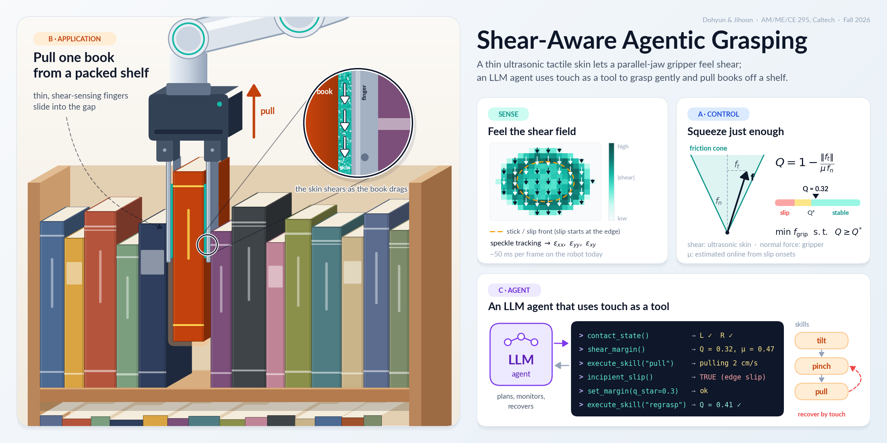

<p align="center">
  
</p>

# Shear-Aware Agentic Grasping

**A thin ultrasonic tactile skin lets a parallel-jaw gripper feel shear; an LLM agent uses that touch as a tool to grasp gently and pull books off a shelf.**

AM/ME/CE 295 research project (Caltech, Fall 2026) · Dohyun ([@DHLeexpress](https://github.com/DHLeexpress)) · Jihoon ([@jhahn2](https://github.com/jhahn2))

> **Status: week 2, laying the foundation.** The topic is drafted, not locked. Latest report: [Lab Report 1](reports/LR1_week02.md) ([Word version](reports/LR1_week02.docx)) · running log: [LOG.md](LOG.md) · [draft proposal](docs/proposal_draft.md) · [related work](docs/related_work.md)

## Idea
Parallel-jaw grippers know how far they closed and roughly how hard they squeeze, but not how close each contact is to slipping. Vision cannot see that either, least of all inside a packed shelf. Our ultrasonic tactile skin on a Robotiq 2F-140 finger measures the shear-strain field at the contact (~50 ms per frame today). We use it at three levels:

| | Layer | What we build | Compared against |
|---|---|---|---|
| **A** | Control | friction-margin grasp quality Q from measured shear → *squeeze just enough* + slip reflex | fixed force · slip-reactive regrasp · LLM-prior force (DeliGrasp-style) |
| **B** | Application | pull one book out of a tightly packed shelf *sideways*: shelves leave no headroom to lift, so thin fingers slide into the gaps, pinch and pull | scripted vision-only tilt → grasp → pull (Trixi-style) |
| **C** | Agent | LLM agent that calls tactile tools (`contact_state`, `shear_margin`, `incipient_slip`, …) to plan, monitor and recover | same agent with vision-only tools; learned visuo-tactile policy (RDP-style, stretch) |

## Repository layout
```
src/shear_agent/
  grasp_quality.py     friction-cone margin Q, required grip force, gentlest closure
  sim/toy_grasp.py     toy 1-D slip simulator + baseline controllers (evaluation harness)
  agent/tools.py       tactile tool schemas + input validation + offline mock gripper
  agent/llm.py         dependency-free LLM client (Anthropic / OpenAI-compatible) + MockLLM
  agent/loop.py        tool-use loop with turn/token accounting
scripts/               run_toy_benchmark.py · run_agent.py · check_llm_api.py · make_hero.py
tests/                 unit tests (stdlib unittest; pytest also works), no API key needed
docs/                  proposal draft, related-work note, refs.bib, figures
reports/               biweekly lab reports (Markdown + Word)
results/               small generated tables (raw data and agent logs stay out of git)
.githooks/             pre-commit hook that blocks API keys and .env files
.github/workflows/     CI: tests, offline agent episode, key scan
LOG.md                 running log
```
Hardware-side code (ultrasound acquisition, ROS 2 wrapper, UR10e/Robotiq drivers) will move into `sensing/` and `ros2_ws/`.

## Quickstart
```bash
git clone https://github.com/DHLeexpress/ME295.git && cd ME295
git config core.hooksPath .githooks           # once per clone: blocks committed keys
python -m venv .venv && source .venv/bin/activate
pip install -r requirements.txt               # numpy, matplotlib (+ pytest); or: pip install -e .
python -m unittest discover -s tests          # 23 tests, offline
python scripts/run_toy_benchmark.py           # -> docs/figures/lr1_toy_benchmark.png, results/toy_benchmark.md
python scripts/run_agent.py --mock            # agent loop on the mock gripper, no key needed
cp .env.example .env                          # add your key, then:
python scripts/check_llm_api.py               # verifies key, network and tool use
python scripts/run_agent.py                   # same episode with the real model
```
Scripts and tests add `src/` to the path themselves, so no install is required.

## LLM API and keys (public repo)
- **Keys live only in `.env`**, which is git-ignored; `.env.example` is the template. The pre-commit hook and CI reject anything that looks like a key, and any `.env*` file other than the template.
- **Providers.** Anthropic Messages API by default (`ANTHROPIC_API_KEY`, `LLM_MODEL`). Any OpenAI-compatible endpoint works with `LLM_PROVIDER=openai`, `OPENAI_API_KEY`, `LLM_MODEL` and an optional `LLM_BASE_URL`.
- **Robust calls.** 60 s timeout; up to 4 retries with exponential backoff on 429 / 5xx / 529 and network errors, honouring `Retry-After`; capped output tokens and agent turns. Token usage is reported per run. The key is never printed, logged or put into error messages.
- **The model cannot command forces.** Every tool call is validated against its schema before it reaches the robot backend (skill names are an enum, 0 ≤ Q\* ≤ 0.8, no unknown arguments). Invalid calls come back to the model as errors. The low-level controller clamps grip force to the gripper's range.
- **Offline by default.** `MockLLM` runs the same loop without a key, so tests and CI never need one.

## Hardware (current)
UR10e · Robotiq 2F-140 (10–125 N grip force) · ultrasonic tactile skin on one finger, second side pending · ultrasound acquisition PC ↔ robot PC over Ethernet/ROS.

## Data and confidentiality
Raw ultrasound frames, recordings, agent run logs and internal lab material are **not** tracked (`data/`, `recordings/`, `results/agent_runs/`, `internal/` are git-ignored). Sensor-design details stay out of this public repo until they are cleared for publication.
