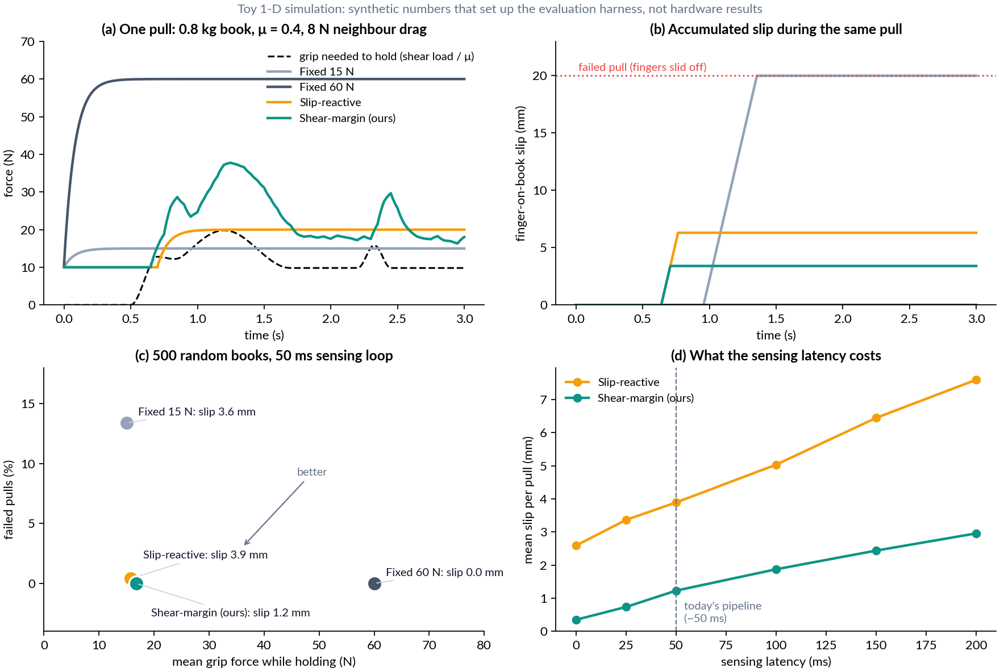

# Lab Report 1 · Weeks 1–2 (due Sun, Oct 18, 2026)

**Shear-Aware Agentic Grasping** · Dohyun ([@DHLeexpress](https://github.com/DHLeexpress)) & Jihoon ([@jhahn2](https://github.com/jhahn2)) · AM/ME/CE 295


| | |
|---|---|
| **Repository** | [github.com/DHLeexpress/ME295](https://github.com/DHLeexpress/ME295) (public) · [commit history](https://github.com/DHLeexpress/ME295/commits/main) |
| **README** | up to date: idea, A/B/C layers, layout, quickstart, API/key handling ([README](../README.md)) |
| **Running log** | [LOG.md](../LOG.md), started Oct 15 |
| **Draft proposal** | [docs/proposal_draft.md](../docs/proposal_draft.md) |
| **Word version** | [LR1_week02.docx](LR1_week02.docx) (2 pages) |

**Goal (draft, to be locked in LR2).** A parallel-jaw gripper knows how far it closed and roughly how hard it squeezes, but not how close each contact is to slipping, and vision cannot see that inside a packed shelf. We ask whether real-time shear sensing from Jihoon's thin ultrasonic tactile skin on a Robotiq 2F-140 helps when it is used two ways: **(A)** inside a friction-margin grip controller and **(C)** as tools an LLM agent can call. The test is **(B)** pulling one book out of a tightly packed shelf *sideways*: shelves leave no headroom to lift a book, so the thin fingers slide into the gaps beside it, pinch, and pull it out horizontally. "Helps" means more reliable and gentler than fixed-force, slip-reactive, LLM-prior and vision-only baselines.

## 1. Progress (from the running log)

**Done**
- **Literature.** Read 3 core papers and 9 adjacent ones, written up as a [related-work note](../docs/related_work.md) (§3).
- **Direction.** Picked A+B+C. The book-shelf application comes from our last discussion with Prof. Burdick. Two other directions were set aside: a learned visuo-tactile policy stays as a stretch comparison, and pretrained optical tactile encoders are dropped (optical → ultrasound domain gap).
- **Repo and environment.** Public repo `DHLeexpress/ME295`. Python package `shear_agent` (numpy + matplotlib only), 23 unit tests passing offline. Raw data and internal material are git-ignored.
- **API access, set up for a public repo.**
  - Keys live only in a git-ignored `.env`; a pre-commit hook and CI reject key-shaped strings and `.env` files.
  - A dependency-free LLM client (Anthropic by default, any OpenAI-compatible endpoint optional) with timeouts, capped retries with backoff, and token/turn limits. It never prints the key.
  - Every tool call from the model is schema-validated before it can reach the robot.
- **Small working pieces (§2).**
  - friction-margin Q and a gentlest-closure helper
  - toy evaluation harness with 4 controllers and a latency sweep
  - tactile tool schemas and the agent's tool-use loop, runnable offline with a scripted mock LLM
  - LLM access check script
- **Hardware carried in from earlier lab work.**
  - Tactile gripper v1: ultrasonic skin on one 2F-140 finger, dummy finger on the other.
  - Real-time pipeline: ultrasound → strain → ROS → UR10e, ~50 ms per cycle.
  - UR10e pushing tests on flat, inclined and compliant surfaces.

**Remaining before LR2.** Lock the question and write the 1-page proposal. Calibrate shear strain → tangential force, and gripper setting → normal force. Measure how fast the Robotiq can change force mid-grasp. Verify the API key. Build a shelf testbed v0.

**Bottlenecks**
- **Double-sided sensing** waits on the new ultrasound system (ETA ~2 weeks), so A and C start with one sensed finger.
- **Latency.** The loop is ~50 ms, and images are the slow link: a single .bmp at ~5 fps vs a 10×10 matrix at ~20 kHz in our link test. Fix: compute strain on the ultrasound PC and stream features only. The toy sweep below shows why this matters.
- **Normal force is hard to read from ultrasound images.** Take f_n from the gripper and use the skin for shear only.
- **The Robotiq takes a force *limit* + position, not torque control.** Mid-grasp force changes may need position-increment squeezing.

## 2. Demo: current state

**Hardware.** Tactile gripper v1 streams shear strains to the UR10e controller in real time. Photos and video are in our internal lab deck. They are not committed while the sensor design is unpublished, and we can show the setup live.

**(a) Toy evaluation harness** (`python scripts/run_toy_benchmark.py`): 500 random books with a 50 ms sensing loop. The numbers are **synthetic**. The simulator encodes our assumptions, and its job is to fix metrics, baselines and a latency budget before hardware time.



| controller | failed pulls | mean slip | mean grip |
|---|---:|---:|---:|
| Fixed 15 N | 13.4 % | 3.6 mm | 15.0 N |
| Fixed 60 N | 0 % | 0 mm | 60.0 N |
| Slip-reactive (Dong et al. style) | 0.4 % | 3.9 mm | 15.7 N |
| **Shear-margin (ours)** | **0 %** | **1.2 mm** | **16.7 N** |

What we learned:
1. Holding Q ≥ Q\* matches the strong grip's 0 % failures at ~28 % of its force, with ~3× less slip than slip-reactive.
2. Slip grows roughly linearly with latency (ours: 0.4 → 1.2 → 3.0 mm at 0 / 50 / 200 ms), so streaming features instead of images is worth doing.
3. Our first controller had more failed pulls than slip-reactive at ≥150 ms latency. Measured shear saturates at the friction limit during gross slip, so the controller needs a slip reflex, and its feed-forward lead must match the loop delay. Both are fixed now.

**(b) Agent tool loop, offline** (`python scripts/run_agent.py --mock`, output trimmed). A scripted mock LLM drives the same loop the real model will use:
```
> execute_skill(skill='insert', book_id='7') -> {"phase": "inserted"}
> execute_skill(skill='pinch', book_id='7')  -> {"phase": "pinched"}
> execute_skill(skill='pull', book_id='7')   -> {"phase": "pulling"}
> shear_margin()                             -> {"Q": 0.0, "mu_hat": 0.45, "grip_N": 10.0}
> incipient_slip()                           -> {"incipient_slip": true}
> set_margin(q_star=0.3)                     -> {"ok": true}
> execute_skill(skill='regrasp', ...)        -> {"phase": "pulling"}
> shear_margin()                             -> {"Q": 0.3, "grip_N": 14.3}
```
Without `--mock`, the same command uses the real model from `.env`. `scripts/check_llm_api.py` verifies the key, the network and tool calling in one short episode. It currently stops at "no API key".

## 3. Related work: what has been tried, where the gap is
Full note with 9 more papers: [docs/related_work.md](../docs/related_work.md).
- **Trixi the Librarian** (Wieczorek et al., arXiv 2022). A PR-2 gets books out bimanually. A Shadow-hand finger tilts the book, the other arm's gripper grasps, releases, regrasps and pulls. It uses no contact sensing, and the one-hand attempt failed. **This is our task baseline for B.**
- **DeliGrasp** (Xie et al., CoRL 2024). An LLM guesses mass, μ and stiffness from text and writes a physics-based grasp policy for a current-limited two-finger gripper. It beats classic adaptive and LLM-as-code policies on 12 delicate items. The parameters are priors, and nothing measures shear. **This is our agentic baseline for A/C.**
- **Reactive Diffusion Policy** (Xue et al., RSS 2025). A slow diffusion policy plus a fast tactile/force loop, trained from AR-teleop demos with GelSight-type sensors. It beats vision-only imitation learning. **This is our scaled-up, learned comparator** (stretch).

**Gap.** Shear feedback has been shown with thick optical fingertips. Book extraction has been done with dexterous hands, special hardware or no touch. LLM grasp agents set force open-loop or watch through vision. No one has tried a *thin shear-sensing parallel-jaw finger* whose margin is exposed to an agent as a tool, on a confined task where vision is weak.

## 4. Next two weeks (→ LR2, Nov 1)
| Task | Owner | Done when |
|---|---|---|
| Lock the research question; 1-page proposal; confirm the team with the TA | both | proposal submitted |
| Shear strain → tangential force calibration (UR10e wrist F/T or load cell) | Jihoon | fit + held-out error in repo |
| Stream strain features (not images) over ROS 2; measure end-to-end latency | Jihoon + Dohyun | latency histogram in repo |
| Robotiq 2F-140: force setting → measured grip force; mid-grasp re-command latency | Dohyun | script + table in repo |
| Verify the LLM API key; first real agent run against the mock backend | Dohyun | `check_llm_api.py` exits 0 |
| Shelf testbed v0 (adjustable packing); finger thickness vs. book gaps; first scripted-baseline pulls | both | photos + trials in LOG |
| Integrate the new ultrasound system when it arrives (both fingers sensing) | Jihoon | both sides streaming |
| Move sensing-side code (acquisition, strain pipeline) into `sensing/` | Jihoon | first commits in the repo |
